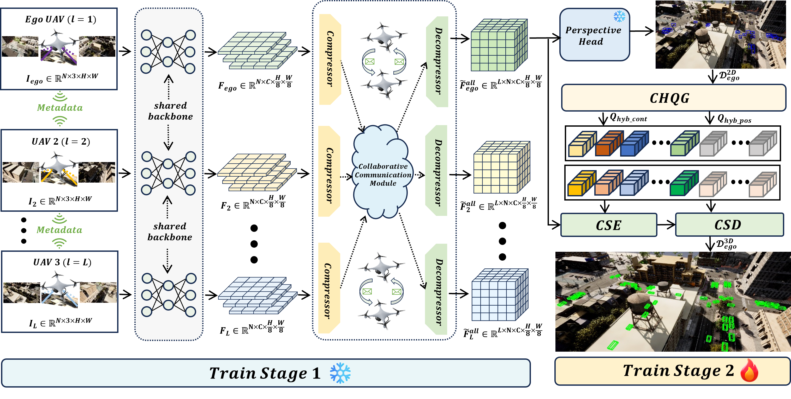
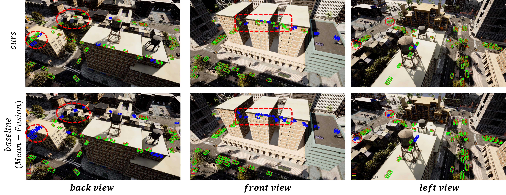
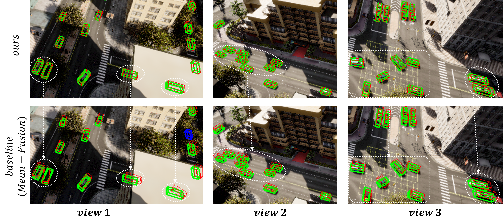

# Col-UAVFormer: A new collaborative framework for multi-UAV 3D-Object Detection

<!-- Template: replace every TODO and every <PLACEHOLDER> before publishing. -->
<!-- All paths and commands below are examples; align them with the released repository. -->

**Authors:** Sixian Chan Member, IEEE, Ziyu Chen, Jian Tao, Qiujie Fan, Yalin Wang Member, IEEE, Cong Bai Member,
IEEE, Xiaoqin Zhang Senior Member, IEEE and Shengyong Chen Senior Member, IEEE  
**Paper:** TODO: paper / preprint URL  
**Code status**:  under preparation（🚩） / partially released / fully released

Official implementation of **Col-UAVFormer**.

## Contents

- [Abstract](#abstract)
- [Framework](#framework)
- [Installation](#installation)
- [Dataset Preparation](#dataset-preparation)
- [Pretrained Models](#pretrained-models)
- [Training](#training)
- [Evaluation](#evaluation)
- [Main Results](#main-results)
- [Visualization](#visualization)
- [Citation](#citation)
- [License](#license)
- [Acknowledgments](#acknowledgments)
- [Contact](#contact)
- [Troubleshooting](#troubleshooting)

## Abstract

With the development of the low-altitude economy, multi-UAV collaborative perception has emerged as an important research direction in aerial intelligent perception, leveraging complementary multi-view observations to mitigate the limited field of view and object occlusion encountered by individual UAVs. Most existing vision-based collaborative 3D perception methods follow a paradigm that first transforms 2D visual features into Bird’s-Eye View (BEV) features and then collaboratively fuses them across UAVs. However, this paradigm suffers from two major limitations. First, BEV feature construction is sensitive to inaccurate depth estimates and calibration errors during view transformation. Second, BEV features may discard view-specific visual details during feature transmission, thereby limiting the full exploitation of complementary multi-view observations. To address these issues, we propose a novel framework, termed Col-UAVFormer for multi-UAV 3D-object detection. In this framework, the Collaborative Spatial Encoder (CSE) directly performs collaborative modeling on 2D visual features to construct a unified collaborative representation space, thereby preserving richer original visual information while mitigating the impact of depth estimation errors. Furthermore, to address the lack of effective priors during decoding, we propose a Conditional Hybrid Query Generator (CHQG), which generates content queries containing object-level semantic information from 2D proposals and constructs position queries endowed with geometric priors through a Conical Relative Positional Encoder (CRPE), thereby guiding the decoder to rapidly locate potential target regions. In addition, we design a task-decoupled training strategy to alleviate optimization conflicts between 2D perception and 3D detection. Finally, extensive experiments on a public multi-UAV collaborative perception dataset demonstrate that Col-UAVFormer achieves an NDS of 89.04% while reducing communication volume by 78.52%, yielding an overall performance improvement of 14.24% over existing state-of-the-art methods.

## Framework



## Installation

### Tested Environment

<!-- List one configuration that has actually been tested. -->
| Component | Tested version / configuration |
| --- |--------------------------------|
| Python | 3.8                            |
| CUDA | 11.3                           |
| PyTorch | 1.10.0                         |
| GPU / GPU memory | 4×RTX3090                        |


### Setup

The commands below are a template. Replace all placeholders with the repository's actual requirements.

```bash
git clone https://github.com/Love-syntacticSugar/Col_UAVFormer.git
```
Please refer to the [installation guide](docs/install/final.md) for detailed environment setup instructions.


## Dataset Preparation

### Download

| Resource    | Download link                                                                                    | Notes                                    |
|-------------|--------------------------------------------------------------------------------------------------|------------------------------------------|
| Dataset     | [UAV3D](https://drive.google.com/drive/folders/1dr0TSTDSmWV1FUn_kuXcrG_pMVoPpKuj?usp=share_link) | UAV3D, v1.0                              |
| Annotations | [UAV3D_v1.0_2DGTBox_v2](todo:xxxxx)                                                              | 2D object annotations additionally provided by the authors of this paper |


### Dataset Structure
```text
UAV3D/
├── v1.0/
│   ├── maps/
│   ├── samples/
│   ├── sweeps/
│   ├── v1.0-test/
│   ├── v1.0-trainval/
│   ├── uav3d_infos_test.pkl
│   ├── uav3d_infos_train.pkl
│   └── uav3d_infos_val.pkl
└── v1.0_2DGTBox_v2/   # 2D object annotations additionally provided by the authors of this paper
    ├── uav2d_infos_test.pkl
    ├── uav2d_infos_train.pkl
    └── uav2d_infos_val.pkl
```

## Pretrained Models

| Weight type             | Download                                         | Usage |
|-------------------------|--------------------------------------------------|----|
| Backbone initialization | [yolo11l.pt](https://github.com/ultralytics/ultralytics) | If you wish to perform two-stage training, this weight will be used for the training in Stage 1.   |
| Backbone initialization | [train_2d_model_only_v2_epoch_24.pth](todo；xxx)  |   If you only wish to proceed with the second stage of training, we also provide the results from the first stage directly. | 

**NOTE**: This README.md covers only the second stage of training; the weights for the first stage have already been provided. Details regarding the two-stage training process will be added later...

## Training

The commands below show the intended documentation structure. Script names, arguments, and configuration paths must be replaced with the actual training interface.

[//]: # (### Stage 1: 2D Perception)

[//]: # ()
[//]: # (```bash)

[//]: # (python <TRAIN_SCRIPT> <STAGE1_CONFIG> <STAGE1_ARGUMENTS>)

[//]: # (```)

[//]: # (### Stage 2: 3D Detection)

```bash
CUDA_VISIBLE_DEVICES=0,1,2,3 torchpack dist-run -np 4 python tools/train.py # Please carefully review the parameters in this script and modify them according to your actual situation.
```

## Evaluation

```bash
python tools/test.py # Please carefully review the parameters in this script and modify them according to your actual situation.
```

## Main Results

| Method | Dataset / split     | NDS (%) | Communication reduction (%)  | Checkpoint        |
| --- |---------------------| --- | --- |-------------------|
| Col-UAVFormer | UAV3D / val dataset | 89.04 | 78.52  | [best.pt](todo；xxxxx) | 

## Visualization




## Citation
If you use this work in your research, please cite our paper.

TODO: 

## License

TODO: 

## Acknowledgments

TODO: 

## Contact

For questions and reproducibility issues, please open a GitHub issue.

**Email:** 211124120029@zjut.edu.cn


## Troubleshooting

### **（1）运行命令**
```Bash
我在4卡4090上使用命令：CUDA_VISIBLE_DEVICES=0,1,2,3 torchpack dist-run -np 4 python /home/csx/disk2/czy/code/UAV3D-IFTR/tools/train.py
却报错：
A process has executed an operation involving a call                                                 
to the fork() system call to create a child process.                                                
As a result, the libfabric EFA provider is operating in                                             
a condition that could result in memory corruption or                                               
other system errors.                                                                                
For the libfabric EFA provider to work safely when fork()                                           
is called, you will need to set the following environment                                           
variable:                                                                                           
          RDMAV_FORK_SAFE                                                                           
However, setting this environment variable can result in
signficant performance impact to your application due to
increased cost of memory registration.
You may want to check with your application vendor to see
if an application-level alternative (of not using fork)
exists.
Your job will now abort.

原因：
由于系统安装了 libfabric，导致出现一个典型的 EFA / libfabric + fork 冲突问题，并非你的代码错误，而是分布式启动方式与底层通信库不兼容导致的。

解决办法1：
添加环境变量：RDMAV_FORK_SAFE=1 ：但训练时间翻倍

解决办法2：
添加临时变量：
export FI_PROVIDER=
export FI_LOG_LEVEL=error
export LD_PRELOAD=
    原理：
    1️⃣ FI_PROVIDER=
    FI_PROVIDER 是 libfabric 的关键环境变量，用来指定底层通信 provider（例如 efa, mlx, tcp 等）
    当你把它 置为空：
    libfabric 不会初始化任何 provider
    所以 fork 时 不会触发 EFA 的 fork-safe 检查
    原理：torchpack 启动时，父进程 import libfabric 或者 RDMA/NCCL buffer，发现没有 provider 就不会初始化 EFA。
    2️⃣ FI_LOG_LEVEL=error
    用来控制 libfabric 的日志级别，避免 info/warning 输出干扰
    本身不影响性能或 fork-safe，只是清理日志。
    3️⃣ LD_PRELOAD=
    LD_PRELOAD 是 Linux 下的 动态库预加载机制
    一些 HPC 镜像可能通过 LD_PRELOAD 预加载 libfabric 或相关 EFA 库
    将其置空：
    禁止 fork 过程中 libfabric 被强制加载
    从而避免 “fork → EFA → RDMAV_FORK_SAFE” 的死循环/性能瓶颈
如果你想永久配置，则写进 ~/.bashrc 即可
```